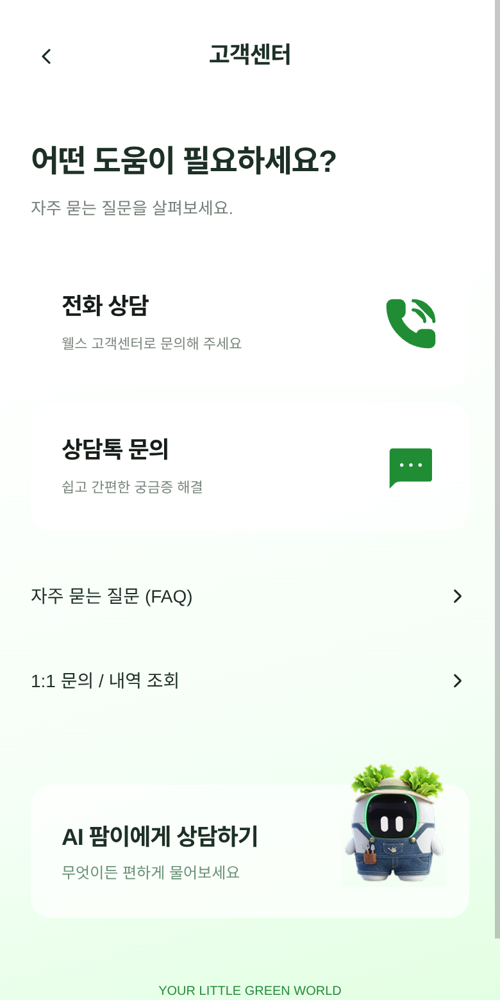
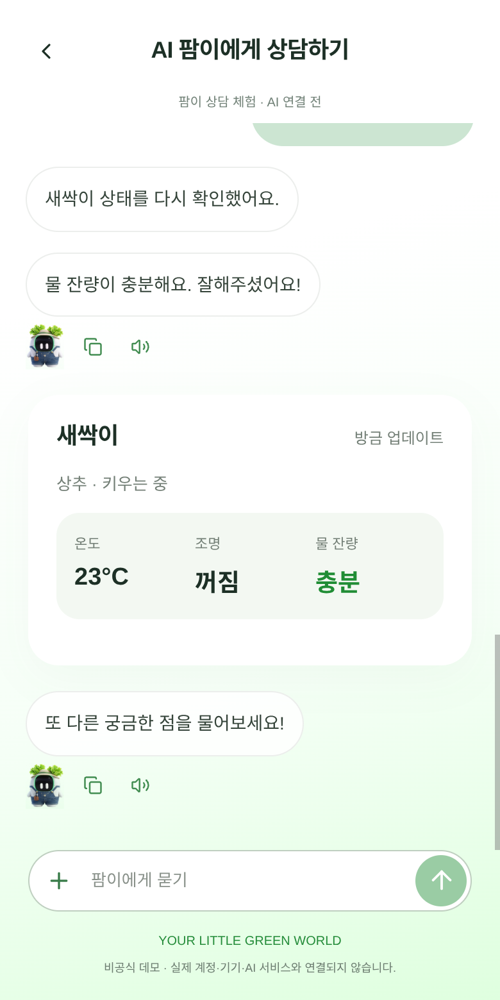

# 고객센터 · 계정 · 팜이 상담 · 3D 미리보기

첨부 디자인의 고객센터를 독립 화면으로 연결하고 FAQ·문의 작성 및 조회를 추가했습니다. 로그인과 팜이 상담은 기존 화면을 보완했습니다.

390×780 CSS 픽셀, 2배 해상도 Chromium에서 **프로덕션 빌드**를 촬영했습니다. 아래는 클릭 가능한 앱 위젯이 아닌 실제 렌더링 캡처입니다.

| 화면 | 캡처 |
| --- | --- |
| 고객센터 | [보기](01-customer-center.png) |
| FAQ 검색과 답변 | [보기](02-faq.png) |
| 문의 내역 | [보기](03-inquiries.png) |
| 로그인 | [보기](04-login.png) |
| 이메일 형식 오류 | [보기](05-login-email-error.png) |
| 비밀번호 오류 | [보기](06-login-password-error.png) |
| 로그인 완료 | [보기](07-login-complete.png) |
| 미니팜 상태 상담 | [보기](08-chat-status.png) |
| 물 보충 가이드 | [보기](09-water-guide.png) |
| 물 보충 완료 | [보기](10-water-complete.png) |
| 팜이 소개 | [보기](11-ai-welcome.png) |
| 3D 분해 | [보기](12-3d-exploded.png) |
| 3D 조립 초기화 | [보기](13-3d-assembled.png) |

## 고객센터

## 팜이 물 보충

## 검증

`node tests/fami-worker.test.mjs` 11개 테스트가 통과했습니다. `tests/ui-smoke.mjs`를 개발 서버와 프로덕션 빌드 양쪽에서 실행했습니다.

FAQ 검색·결과 없음·초기화·펼치기, 문의 작성·새로고침 유지·삭제 취소·삭제, 이메일과 비밀번호 오류, 세 가지 소셜 버튼 안내, 체험 로그인과 기기 등록, 전원·온도·조명·급수·모드·예약·잠금, 과거 상담 상태 보존, 물 보충 완료와 중복 클릭 방지, 클립보드 복사, 작은 뷰포트에서 입력창 유지, 320/390/768px 가로 넘침 없음, WebGL 분해·시점 회전·확대/축소·키보드 회전·조립 초기화를 확인했습니다. 브라우저 실행 예외는 없었습니다.

기기와 문의는 체험용입니다. 문의는 현재 브라우저 탭에만 저장하며 실제 고객센터에 전송되지 않습니다. 외부 소셜 인증 및 실제 AI 모델 호출은 연결·검증하지 않았습니다. 3D 모델은 기존 사진 기반 시연 모델을 보존했으며 실제 CAD 구조를 의미하지 않습니다.
